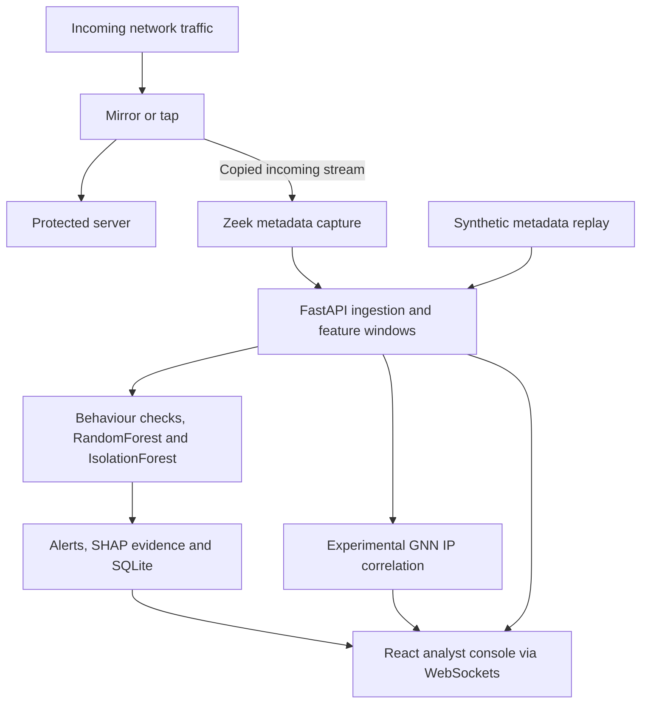

# VEIL — Passive Threat Detection for Unidirectional IP Traffic

**Team Blue Lock · Smart India Hackathon · Problem statement SIH26145**

VEIL is a research prototype that analyses network metadata from a copied, incoming traffic stream and presents suspicious activity with evidence for analyst review. It combines behavioural checks, RandomForest classification, IsolationForest anomaly detection, SHAP explanations, and experimental GNN-based IP correlation.

The intended observation point is a mirror or tap before the protected server. The original traffic continues to the server; VEIL processes the copied stream and does not perform inline blocking or query production hosts.

**Start with the synthetic replay below.** It demonstrates the application without Zeek, administrator privileges, or network traffic generation. Use the isolated Linux lab afterward to evaluate capture and the one-way observation boundary.

> This repository is a working prototype, not a certified production security product. Bundled models use synthetic training data. Alerts and graph patterns are investigation leads, not proof of compromise.

## Contents

- [What an evaluator can inspect](#what-an-evaluator-can-inspect)
- [Architecture](#architecture)
- [Requirements](#requirements)
- [Quick start](#quick-start)
- [Evaluator walkthrough](#evaluator-walkthrough)
- [Live passive-capture lab](#live-passive-capture-lab)
- [Detection and interpretation](#detection-and-interpretation)
- [Validation and evidence](#validation-and-evidence)
- [Configuration and data](#configuration-and-data)
- [Training with reviewed data](#training-with-reviewed-data)
- [Troubleshooting](#troubleshooting)
- [Repository guide](#repository-guide)
- [Scope and limitations](#scope-and-limitations)

## What an evaluator can inspect

| Capability | What to look for |
| --- | --- |
| Packet metadata browser | Observed addresses, ports, protocols, and packet records, separate from detections |
| Detection feed | Behavioural suspicions and persistent anomalies with measured feature values |
| Explainable classifier output | SHAP contributions explaining the RandomForest vote |
| Traffic graph | Observed IP relationships and detection-linked nodes |
| Experimental GNN correlation | Learned scan/SYN-convergence patterns, candidate IPs, and supporting observed features |
| Replay and live ingestion | Synthetic metadata replay first; Zeek log ingestion for the live lab |
| Evidence export | Downloadable packet metadata and alert records |
| Local persistence | SQLite alert and feature-window storage |
| Analyst access | Locally created account, authenticated API/WebSocket access, and session controls |

JA4 integration and PostgreSQL storage are optional. Base replay and base capture do not require either.

## Architecture



The mirror's isolation is a deployment property that must be tested. The included namespace lab uses software mirror/drop rules; it does not certify a hardware data diode.

**Stack:** Python, FastAPI, WebSockets, scikit-learn, SHAP, NumPy/SciPy, SQLite, React, TypeScript, Tailwind CSS, and React Flow. Zeek supplies live metadata. The GNN implementation does not require a GPU or PyTorch.

## Requirements

| Component | Replay evaluation | Live lab |
| --- | --- | --- |
| Operating environment | Linux with Bash; Kali is the documented target | Linux host or VM supporting network namespaces and traffic-control rules |
| Python | 3.12–3.14 with pip and venv; recorded execution validation used 3.12 | Same |
| Git | Required for the clone instructions | Same |
| Node.js and npm | Required to build the frontend in a fresh GitHub checkout; Node 22+ recommended | Same initial build |
| Zeek | Not required | Installed executable available through PATH or `ZEEK_BIN` |
| Elevated privileges | Not required for the application/replay | Required for namespace setup and capture |
| Additional utilities | Internet access to install Python/npm dependencies | `iproute2`, `iputils-ping`, `tcpdump`; `tcpreplay` for optional packet replay |

Python 3.14 dependency-wheel resolution was checked in earlier validation; that is not equivalent to runtime validation on every host. The supplied shell scripts use Linux paths and are not native PowerShell instructions.

## Quick start

### 1. Clone and install

Run these commands in a terminal:

```bash
git clone https://github.com/Tobi-u3/VEIL.git
cd VEIL
bash scripts/install.sh
```

Run all subsequent commands from this repository root unless a step explicitly changes directory. The installer creates `.venv`, installs Python dependencies, and builds the UI with npm when `frontend/dist/index.html` is missing. **The GitHub checkout does not include that built UI**, so install Node/npm before running the installer.

To select a particular installed Python:

```bash
PYTHON=python3.12 bash scripts/install.sh
```

The installer does not replace the operating system's Python.

### 2. Create an analyst account

```bash
.venv/bin/python scripts/create_user.py
```

Enter a username and a password containing **15–128 characters**. There is no default login or public registration.

### 3. Start VEIL

For the initial replay evaluation, ensure no live-log configuration is inherited:

```bash
unset VEIL_LOG
bash scripts/start.sh
```

Open **[http://127.0.0.1:8000](http://127.0.0.1:8000)** on the same machine and sign in. Keep the terminal running. Stop the application with **Ctrl+C**.

### 4. Run the demonstration

Click **Run demo replay**, then follow the walkthrough below.

The replay feeds synthetic metadata through the application pipeline. It sends no packets and does not validate Zeek capture, mirror isolation, or real-network detection accuracy.

## Evaluator walkthrough

| Step | Action | Expected observation |
| --- | --- | --- |
| 1 | Sign in and run demo replay | Packet metadata begins appearing as replay events are processed |
| 2 | Inspect the packet browser | Addresses, protocols, and ports are visible independently of the detection feed |
| 3 | Open Detections and select a result | Measured evidence and trigger details are available for review |
| 4 | Inspect classifier evidence | SHAP explains the RandomForest vote; rule/anomaly triggers are shown separately |
| 5 | Open Traffic graph | Observed connections and detection-linked IPs are visible |
| 6 | Inspect the GNN IP correlation panel | Candidate IPs and learned patterns can be reviewed with their observed features |
| 7 | Export alerts and packet metadata | Records can be retained for independent inspection |
| 8 | Review system status and validation documents | Distinguish application connectivity, ingestion mode, and independently verified capture |

The demonstration includes a port-scan pattern and multi-source SYN convergence. A GNN group requires multiple qualifying sources; a single-source scan can still produce a node pattern. GNN scores do not create or upgrade alerts.

For a recorded evaluation, retain the repository commit, environment versions, replay/live mode, exported evidence, and actual test output. Do not present synthetic replay as a live attack capture.

## Live passive-capture lab

This optional exercise creates disposable client, attacker, server, and monitor namespaces. Controlled traffic targets the lab server at `10.77.0.20`. It does not attach the lab to `wlan0`.

### 1. Prepare and verify the boundary

Check the existing Zeek installation:

```bash
zeek --version
```

On Kali/Debian, install missing lab utilities:

```bash
sudo apt update
sudo apt install -y iproute2 iputils-ping tcpdump tcpreplay
```

Create and verify the lab:

```bash
sudo bash scripts/lab-up.sh
sudo bash scripts/verify-lab.sh
```

Both isolation checks must pass: server replies stay out of the observer, and test frames injected by the observer cannot reach the server. Save the verification output.

### 2. Run the lab in four terminals

Open each terminal in the cloned **VEIL repository root**. Stop the earlier replay backend before starting Terminal 3.

**Terminal 1 — HTTP test server**

```bash
mkdir -p data/server-public
sudo ip netns exec veil-server python3 -m http.server 8000 --bind 10.77.0.20 --directory "$PWD/data/server-public"
```

**Terminal 2 — Zeek capture**

```bash
sudo env PATH="$PATH" ZEEK_BIN="$(command -v zeek)" bash scripts/capture.sh
```

If Zeek is not on PATH, replace the `ZEEK_BIN` value with its absolute executable path. Leave capture running.

**Terminal 3 — live application**

```bash
VEIL_LOG="$PWD/data/live/veil_events.log" bash scripts/start.sh
```

Sign in again at [http://127.0.0.1:8000](http://127.0.0.1:8000). Verify live mode. Replay is disabled while a live log is configured.

**Terminal 4 — normal traffic, then bounded test patterns**

```bash
sudo ip netns exec veil-client "$PWD/.venv/bin/python" scripts/lab-traffic.py normal
sudo ip netns exec veil-attacker "$PWD/.venv/bin/python" scripts/lab-traffic.py scan
sudo ip netns exec veil-attacker "$PWD/.venv/bin/python" scripts/lab-traffic.py syn
sudo ip netns exec veil-attacker "$PWD/.venv/bin/python" scripts/lab-traffic.py dns
sudo ip netns exec veil-attacker "$PWD/.venv/bin/python" scripts/lab-traffic.py beacon
```

Check that the metadata log grows and packet counters move while traffic runs. A connected WebSocket only confirms UI transport. Beaconing needs several separate connections and approximately 30 seconds; SYN-rate results depend on the observed generator throughput. Inspect actual evidence rather than assuming every pattern produces an alert.

### 3. Stop and clean up

Stop the server, capture process, and backend with Ctrl+C, then run:

```bash
sudo bash scripts/lab-down.sh
```

For optional JA4/TLS tests, offline PCAP processing, isolated `tcpreplay`, and capture measurements, see [the demonstration guide](docs/DEMO.md). Where older guides refer to an extracted ZIP directory, use this cloned repository root.

## Detection and interpretation

- **Feature extraction:** twelve metadata features are analysed in completed two-second source/destination windows.
- **TCP scan suspicion:** at least sixteen distinct destination ports from TCP SYN-without-ACK probes within a rolling ten-second window. ACK/data packets and SYN-ACK replies do not inflate this count. Normal ping to one destination is not a TCP port scan.
- **SYN-rate/convergence suspicion:** high rate must be supported by a predominantly SYN-probe pattern. Ordinary high-volume downloads are not sufficient. This is not comprehensive UDP, ICMP, or HTTP flood detection.
- **RandomForest:** provides supporting classifier votes. An unsupported vote alone does not create a named attack alert.
- **IsolationForest:** unknown anomalies require three consecutive populated outlier windows, with at least four packets per window and gaps no greater than five seconds. This reduces isolated alerts but can miss short bursts.
- **SHAP:** explains RandomForest output only. It does not explain the GNN or prove an attack occurred.
- **GNN correlation:** a trained directed GraphSAGE variant examines a rolling 30-second graph. Scores are uncalibrated pattern votes; shared destinations and embedding similarity do not prove coordination or malicious ownership.
- **JA4:** optional fingerprint evidence supplied by the installed Zeek plugin. The default watchlist is empty, and encrypted content is not decrypted.

Read [GNN design and limits](docs/GNN.md) and [the model card](docs/MODEL_CARD.md) before interpreting model scores.

## Validation and evidence

Run locally after installation and account creation:

```bash
.venv/bin/python scripts/doctor.py --require-account
.venv/bin/python -m unittest discover -s tests -v
.venv/bin/python scripts/benchmark.py
```

| Evidence | What it supports |
| --- | --- |
| [Recorded validation](docs/VALIDATION.md) and [test log](docs/test-results.txt) | Earlier detection-update checks, including 40 recorded passing tests; not a claim that the current checkout was just retested |
| [GNN validation](docs/gnn-validation.json) and [GNN test log](docs/gnn-test-results.txt) | Separate recorded evidence for the graph extension |
| [Startup smoke check](docs/startup-smoke.json) | Recorded application startup, authentication, and replay checks |
| [Metadata benchmark](docs/benchmark.json) | Recorded processing measurement; rerun on the evaluation host |
| [GNN model report](models/gnn-report.json) | Synthetic graph evaluation and model configuration |

The recorded metadata benchmark processed 7,538 events in 17.653 seconds, approximately **427 events/second**. It did not meet the retained 1,000 events/second target. This is not wire-speed capture throughput, end-to-end alert latency, or real-network accuracy.

Live Zeek capture, JA4 integration, mirror enforcement, and packet loss need separate host-level verification. Existing reports describe their original validation runs; the commands above produce evidence for the evaluator's own checkout.

## Configuration and data

| Setting or location | Purpose |
| --- | --- |
| `VEIL_LOG=/absolute/path/to/veil_events.log` | Select live log ingestion; disables replay |
| `VEIL_GNN=0` | Disable experimental GNN collection/inference |
| `VEIL_JA4=1` | Enable optional JA4 policy when running the capture script |
| `ZEEK_BIN=/absolute/path/to/zeek` | Select the installed Zeek executable |
| `DATABASE_URL` | Optional PostgreSQL connection; see [configuration example](compose.yml) |
| `data/veil.sqlite` | Default local alert and feature-window database |
| `data/ja4-watchlist.json` | Optional fingerprint watchlist |
| `models/` | Model artifacts and reports |

SQLite needs no separate database service. A configured PostgreSQL connection failure stops startup; the recorded validation did not exercise PostgreSQL.

Alerts and feature windows persist in SQLite. The dashboard restores the latest 100 alerts; periodic cleanup limits each database table to 10,000 rows. Packet browsing retains up to 10,000 metadata records in memory. Packet counters, active windows, GNN state, and login sessions reset on restart.

The live follower handles partial/malformed lines and log rotation/truncation, but rereads an existing log from its beginning after restart. This can reproduce alerts; exactly-once ingestion is not implemented. A new capture folder does **not** clear historical alerts in the existing database. For independent evaluations, use a separate clone/data directory and retain earlier evidence.

The application binds to loopback by default. Read [security guidance](docs/SECURITY.md) before configuring remote analyst access.

## Training with reviewed data

Export captured feature windows:

```bash
.venv/bin/python scripts/export_features.py --output unreviewed_live_features.csv
```

Assign independently verified labels, then use separate training and later validation sessions:

```bash
.venv/bin/python scripts/train.py --train-csv reviewed_training.csv --validation-csv reviewed_validation.csv
```

Both CSVs require all feature columns from `backend/features.py::FEATURES` and a `label` column. Minimum inputs are 100 training rows and 20 validation rows, with benign and at least one attack class in training. These are input checks, not sufficient sample sizes for operational claims.

Accepted labels: `benign`, `ddos`, `scan`, `dns_anomaly`, `beaconing`, `encrypted_suspicion`, and `large_transfer`. Label transfers by independently established context; high volume alone does not establish an attack. Use the current `veil-v2-tcp-probe-ports` feature schema.

Replace the anomaly baseline with at least 1,200 reviewed benign feature windows:

```bash
.venv/bin/python scripts/train_isolation.py --benign-csv /absolute/path/reviewed_benign.csv
```

Restart after replacing models. Running `scripts/train.py` without CSV arguments regenerates the synthetic demonstration classifier. Never use VEIL's own predictions as ground truth. For separately labelled graph datasets and split requirements, see [GNN retraining](docs/GNN.md#retraining).

## Troubleshooting

| Symptom | Check or action |
| --- | --- |
| Installer cannot find a supported Python | Install Python 3.12–3.14 with venv support and select it with `PYTHON=...`; do not replace system Python |
| Installer asks for npm, or the browser shows a build message | Install Node/npm, then run `REBUILD_UI=1 bash scripts/install.sh` |
| Login is unavailable | Run `.venv/bin/python scripts/create_user.py`, then restart; there are no default credentials |
| Port 8000 is already in use | Stop the earlier VEIL backend before starting another |
| Replay is disabled | Stop the backend, run `unset VEIL_LOG`, and restart for replay mode |
| Live mode shows no new records | Check traffic generation, the absolute log path, Zeek output, and mirror counters |
| Zeek is missing under sudo | Supply its absolute path through `ZEEK_BIN` |
| Namespace setup reports insufficient permissions | Use a Linux host/VM with namespace privileges; use metadata replay if the environment cannot support the lab |
| Ping is captured but no scan alert appears | Expected: ping is ICMP, not a multi-port TCP SYN scan |
| GNN is unavailable or reaches capacity | Inspect its status and model artifact; normal detection continues; see [GNN limits](docs/GNN.md#timing-and-limits) |
| Old alerts remain after changing capture logs | Alerts persist in SQLite independently of the capture-log directory |
| Alerts reappear after restart | Existing live logs are reread; preserve evidence and use a fresh log for a clean run |

When reporting a problem, include the commit, OS/Python versions, replay or live mode, failing command, and final error output. Exclude credentials and sensitive captured addresses.

## Repository guide

| Path | Purpose |
| --- | --- |
| [backend/](backend/) | API, authentication, ingestion, feature extraction, detection, correlation, and storage |
| [frontend/](frontend/) | React/TypeScript analyst console |
| [zeek/](zeek/) | Metadata capture policy and optional JA4 adapter |
| [scripts/](scripts/) | Installation, account creation, startup, lab, training, and validation commands |
| [models/](models/) | Bundled model artifacts and training reports |
| [tests/](tests/) | Automated application and model tests |
| [docs/](docs/) | Architecture, demonstrations, model limits, security, and recorded evidence |
| [data/](data/) | Demo inputs and local runtime data |

Additional references: [architecture](docs/ARCHITECTURE.md), [third-party components](docs/THIRD_PARTY.md), [security](docs/SECURITY.md), and [model card](docs/MODEL_CARD.md).

## Scope and limitations

- Incoming-only observation cannot confirm server responses, attack success, full exfiltration, or reverse traffic ratios.
- Capturing packets addressed to a laptop's Wi-Fi interface is not equivalent to an isolated pre-server mirror and does not expose arbitrary traffic elsewhere on the network.
- Synthetic training and test results do not establish real-network precision, recall, false-positive rate, or operational readiness.
- GNN correlation is experimental, ephemeral, and capacity-limited; it does not alter the existing alert decisions.
- JA4/TLS and QUIC depend on compatible installed components and separate verification.
- Network isolation, capture loss, real-world model evaluation, and deployment security must be validated in the target environment.

Use VEIL to evaluate passive metadata analysis, reviewable detection evidence, and graph-based investigation through reproducible replay and controlled lab exercises.
